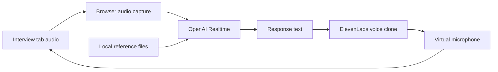

# Voice Interview Lab

Build a local voice agent that answers an AI interviewer with Justin's facts and his ElevenLabs voice clone.

## Scope

The target is an AI interviewer on a web page.
Start with a controlled test page before connecting another interview website.
The local project is `/Users/iamsegbedji/work/projects/voice-interview-lab`.

Use TypeScript for the server and browser code.
Use Bun for the runtime, package manager, and browser build.
Use Hono for server routes and HTTP request logging.
Use oxfmt for formatting and oxlint for lint checks.
Use Eleven v4 (`eleven_v4`) for speech generation through the HTTP streaming endpoint.
Follow the shared [code conventions](../engineering/code-conventions.md) and [engineering workflow](../engineering/workflow.md).

## Voice architecture

OpenAI Realtime receives audio and produces response text.
ElevenLabs converts that text into speech with Justin's existing voice clone.
The application controls audio playback, interruptions, and the stop control.

OpenAI does not accept an ElevenLabs voice ID as its native output voice.
Realtime supports audio input with text output through `output_modalities: ["text"]`.
The response text can then enter ElevenLabs text-to-speech.
See [Realtime conversations](https://developers.openai.com/api/docs/guides/realtime-conversations) and [ElevenLabs speech streaming](https://elevenlabs.io/docs/api-reference/text-to-speech/stream).

OpenAI also supports its own custom voices from recordings.
That feature requires eligible account access and separate consent and sample recordings.
An existing ElevenLabs clone cannot transfer through its voice ID.
See [OpenAI custom voices](https://developers.openai.com/api/docs/guides/custom-voices#create-a-voice-from-a-recording).

## Test sequence

1. Connect an AI interviewer and the candidate agent inside the local test page.
2. Pass actual audio between the agents.
3. Check the transcript against the reference files.
4. Measure the delay before candidate speech starts.
5. Check interruption and stop behavior.
6. Open the separate interviewer page.
7. Capture that tab's audio and return candidate speech through a virtual microphone.
8. Test the selected external interview website.

The direct test does not prove compatibility with another website.
It avoids virtual microphone setup during the first conversation check.
The separate-tab test checks the browser audio path.

For the return path on macOS, evaluate BlackHole as a virtual microphone.
The interview page selects that device as its microphone input.
Keep interview audio on a separate output to prevent feedback.
See [BlackHole virtual microphone setup](https://github.com/ExistentialAudio/BlackHole/wiki/Use-BlackHole-as-a-Virtual-Microphone).

## Reference material

Read reference files from their existing locations.
Do not copy the complete application folder or blog archive into the project.

| Source | Purpose |
| --- | --- |
| `~/Desktop/applications/PROFILE.md` | Career facts and source routing |
| `~/Desktop/applications/SATQUIZ-HISTORY.md` | Dated SatQuiz evidence and claim limits |
| `~/Desktop/applications/FABRIC-HISTORY.md` | Fabric work evidence |
| `~/Desktop/applications/RECENT-ENGINEERING-EVIDENCE.md` | Recent work evidence and verification limits |
| `~/work/projects/segbedji/src/lib/data/about.md` | Writing style |
| `~/work/projects/segbedji/src/lib/data/bio.md` | Writing style |

For the prototype, include this small source set in the candidate instructions.
Use dated evidence when sources disagree.
Use website text for style, rather than current factual claims.
State uncertainty when the sources do not support an answer.
Prompt instructions alone do not guarantee factual accuracy.
Check generated claims against the source evidence during live tests.

## Local operation

The project README owns the minimum start commands.
The application binds to the loopback interface.
Keep API keys on the server.
Set provider keys and `ELEVENLABS_VOICE_ID` through the project environment.
Bun loads `.env` when the server starts.
Agents must not open that secret file.
Keys entered through the local setup form stay in server memory.
Do not save them in browser storage or source files.
The environment variable template lists the required settings.
A direct voice ID needs only Text to Speech access on the ElevenLabs key.
Listing account voices also needs Voices read access.

Starting a candidate session sends the selected reference text to OpenAI.
Candidate response text goes to ElevenLabs for speech generation.
Do not send page video to either provider.
Conversation transcripts stay in browser memory unless the user exports them.
Live tests use paid provider APIs.

## Server logs

Hono's built-in logger records HTTP requests and their duration.
Its print function adds the request ID and removes query strings.
The server prints one line for each voice activity event.
Voice activity lines include a UTC timestamp, severity, and event name.

- `requestId` links an HTTP request to its provider request and speech stream.
- `callId` links browser state events to the candidate or interviewer.
- Duration fields use milliseconds.
- Provider failures include status, request ID, and available error identifiers.

Session logs show creation, connection state, speech detection, reply generation, and stop requests.
Speech logs show generation, the first audio bytes, total bytes, completion, and cancellation.
Browser playback logs show scheduled audio and interruptions.
Startup and speech-generation logs identify the active ElevenLabs model.
Successful static-file requests and status checks do not produce routine log lines.

The browser sends selected state events to the server.
This is necessary because Realtime media travels directly between the browser and OpenAI.
Diagnostic delivery failures do not stop the conversation.

Logs exclude API keys, authorization headers, SDP, reference text, reply text, and audio contents.
Only configured-key indicators and content sizes are logged.
Provider messages are excluded because they can contain request values.

Restart the server after a server-code change.
Refresh the page after the browser build changes.

## Current state — 24 November 2026

The first Bun and TypeScript implementation is complete.
The page supports a direct conversation test, a separate interviewer, and tab audio capture.
It accepts a direct ElevenLabs voice ID from the environment or page input.
It includes transcript export, speech cancellation, and a stop control.
Formatting uses oxfmt. Lint checks use oxlint.

Justin added the provider keys and voice ID through `.env`.
The agent did not open that file or print the keys.
The OpenAI account model list includes the configured Realtime model.

The type check, lint check, and browser build passed.
The local page and compiled browser script returned HTTP 200.
Requests for `.env` and server source returned HTTP 404.
A cross-origin key update returned HTTP 403.

The live conversation attempt returned HTTP 400 during OpenAI session setup.
The request now sends SDP and session configuration as string form fields.
Justin reports that the application appears to work after the server restart.
A live Browse check completed an interviewer question, a cloned answer, and the next question.
An external interview website has not been checked.

Server activity logs now include browser state events and speech-stream timing.
Manual checks use simulated provider responses for failures and stream cancellation.
No unit test files are retained.

The silent-audio fault was reproduced in Chrome with Browse.
The browser received RTP packets but produced no decoded samples for Web Audio.
Each remote audio stream now has a muted media element that starts the decoder.
Web Audio then handles playback and audio routing.
Session stop removes these media elements.
See [Chromium issue 40094084](https://issues.chromium.org/issues/40094084).

After this change, the candidate received the interview question and generated an answer.
Cloned speech was decoded and scheduled for playback.
The return stream now includes a continuous silent source between speech buffers.
This keeps the capture clock active so turn detection can identify the end of an answer.
Session stop treats an already-closed provider call as a successful stop.

The speech default was updated to Eleven v4 at Justin's request.
A direct API check with his configured clone returned HTTP 200 and non-empty audio.

## Speech delivery

The candidate prompt uses short clauses, contractions, and a short first sentence.
A brief hesitation can fit a question that requires reflection.
It stays attached to the answer clause and occurs at most once per answer.
Simple factual answers do not require a hesitation.

The speech request adds a conversational, unhurried delivery tag for v4.
The delivery tag is separate from the displayed transcript.
Voice stability is 0.4 and similarity is 0.75.
These settings are a starting point for listening checks.
The speech endpoint accepted these settings and returned non-empty audio after the Hono migration.
Eleven v4 does not support the speed parameter.
See [voice settings](https://github.com/elevenlabs/skills/blob/main/text-to-speech/references/voice-settings.md) and [audio tags](https://elevenlabs.io/blog/elevenlabs-audio-tags-list).

## Delay reduction proposals

One v4 reply started audio about seven seconds after turn detection.
Another reply took about 3.6 seconds, based on server log timestamps.
These are individual observations with different answers.
They are not a model benchmark.
Browser log delivery can add about 150 milliseconds to event receipt times.

For the second observed reply, OpenAI produced its first text after about 0.84 seconds.
ElevenLabs returned its first audio bytes about 0.80 seconds after the speech request.
The complete first-sentence audio arrived after about 2.50 seconds.
The browser currently waits for that complete audio file before decoding and scheduling it.

| Priority | Proposed change | Expected effect and tradeoff |
| --- | --- | --- |
| 1 | Use a persistent v4 Turbo Text to Dialogue WebSocket and play PCM chunks as they arrive. | Removes whole-file waiting and repeated sentence connections. Requires new buffering and cancellation logic. |
| 2 | Stream a short first clause, then continue the answer. | Starts useful speech earlier. Chunk boundaries must preserve natural delivery. |
| 3 | Change semantic turn detection from low to medium eagerness. | Reduces waiting after a question. Check that short pauses do not cause interruptions. |
| 4 | Use a compact factual summary with detailed evidence available when needed. | May reduce model work. Check factual coverage before removing source material. |

Start with priorities 1 and 2 together.
Keep the existing voice clone and compare normal speech samples before accepting the transport change.
Measure the first meaningful answer, not a filler used to occupy the delay.
Hono changes routing structure. It does not remove speech-generation or playback buffering delays.

See [v4 Turbo streaming](https://elevenlabs.io/docs/eleven-api/guides/how-to/websockets/realtime-tdd).
The listed delay changes remain proposals until implemented and checked.

Use Browse with the `justin-okupter` profile for further browser tests.
Use Justin's existing server on port 4317.
The separate agent-browser session and extra test server were stopped.

## Open checks

- Compare the revised speech delivery by listening to full answers.
- Collect comparable timing samples when a proposed latency change is implemented.
- Check interruptions across both providers.
- Check what the model remembers after interrupted speech.
- Check microphone routing on the target website.
